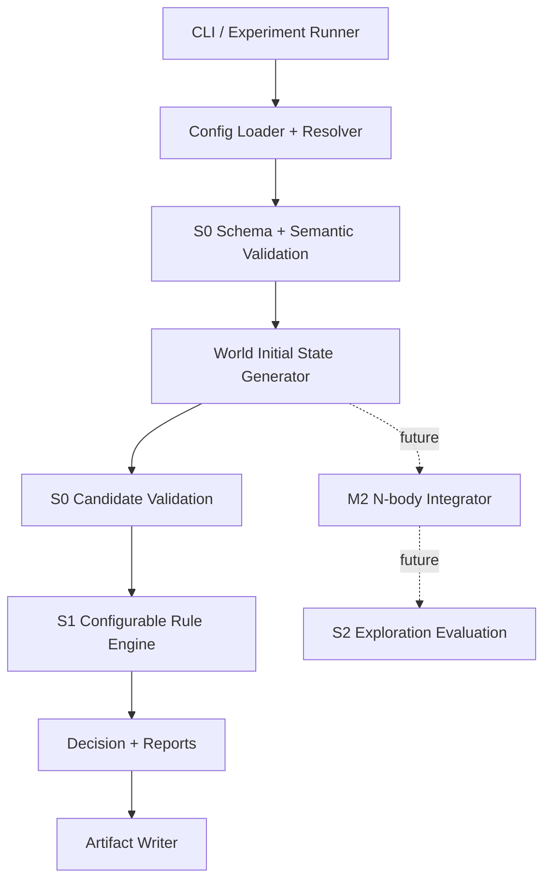

# 02 — P0-M0/M1 架构

## 1. 单体模块边界

### 主要包

- `common`: SI常数、坐标系、稳定序列化/哈希、数值工具。
- `config`: YAML安全加载、schema结构校验、预置展开、跨字段约束、配置冻结。
- `world.models`: CelestialBody、WorldInitialState、profile引用。
- `world.generators`: `CartesianGenerator` 与 `HierarchicalOrbitGenerator`。
- `screening`: 规则协议、规则注册表、S0/S1、决策聚合。
- `experiments`: 批量候选运行、统计、实验产物清单。
- `storage`: 文件输出（不需要数据库）。
- `cli`: `config validate`、`config resolve`、`world generate`。

## 2. 依赖方向

`cli -> experiments -> (world.generators, screening, storage) -> common`。规则实现允许只读取不可变的初态；**不得修改初态**。生成器不得决定候选是否合格。输出层不得参与科学判定。

## 3. 生命周期

1. 加载配置和预置规则；覆盖优先级：内置默认 < preset < 实验文件显式覆盖。
2. 检查schema和语义；产出完整 `ResolvedExperimentConfig`；SHA-256哈希。
3. 对 `candidate_index = 0..count-1`，按独立可重现RNG子流生成候选。
4. 执行S0；若失败，结果 `INVALID`，跳过S1并记录原因。
5. 执行已解析的S1规则；被禁用的报告 `SKIP`，执行出错则 `ERROR`。
6. 聚合决策：S0失败/规则ERROR => INVALID；有触发拒绝策略的FAIL => REJECTED；否则 ACCEPTED。
7. 写出全部候选和汇总，包含失败候选；文件写入采用临时文件+原子替换，避免部分损坏。

## 4. 规则执行不承载积分

当前规则只能基于初态判定；不能假装检测未来轨道稳定、潮汐撕裂、气候适宜性。相关S2规则标记 `NOT_IMPLEMENTED`，而非虚构PASS。

## 5. 未来 M2 集成协议

建议预留 `NBodyIntegrator.integrate(initial_state, settings) -> SimulationResult` 抽象协议（文档/typing Protocol即可）。M2需独立保存积分器状态和事件处理策略，不能将初始碰撞规则等同于运行期碰撞响应。

## 6. 错误分类

- `ConfigError`: 配置有未知字段、非法值、冲突或未知规则。
- `CandidateInvalid`: S0输入不满足最低数据/数值契约。
- `RuleEvaluationError`: 规则运行失败。计入INVALID并记录堆栈到调试日志，用户报告只显示可读错误信息。
- `SerializationError`: 输出失败。程序以非零退出，并保留失败上下文。
